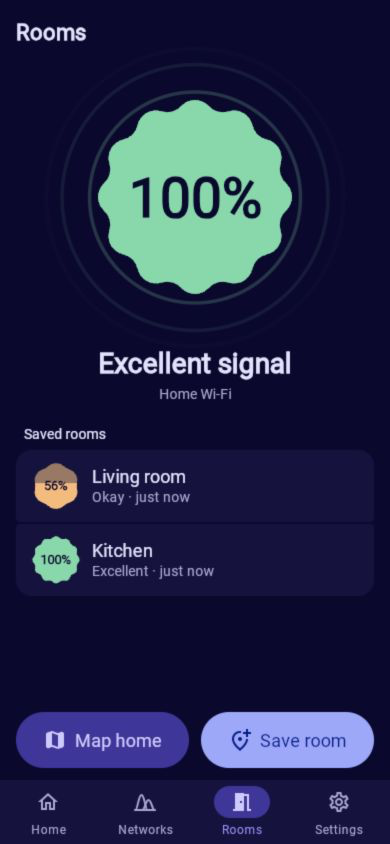
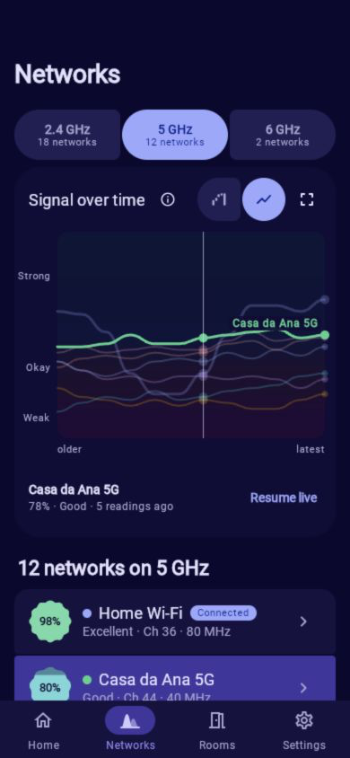
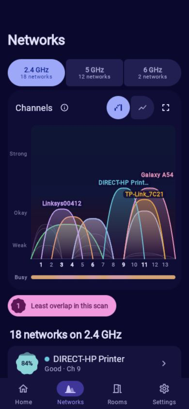
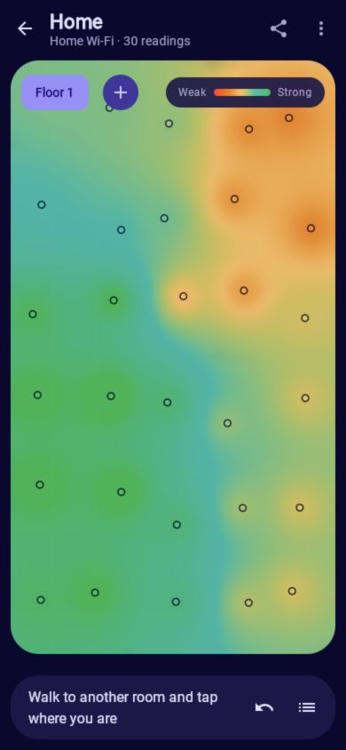

  

<h1 align="center">WiFi Weakspot</h1>

<b>Find the rooms where Wi-Fi gets weak. Compare before and after a change.</b> 
A Wi-Fi analyzer for Android that speaks plain language.

  
  
  
  

Screenshots use the browser demo with simulated Wi-Fi data. The demo shares the Android app’s interface; it does not measure your browser’s Wi-Fi.

## Find your weak spots

**Compare rooms.** Save a reading where the connection feels unreliable, then check another room. Clear signal labels and a fixed percentage scale make the differences easy to understand. Recheck after moving your router to see whether the signal improved.

**Map your coverage.** Tap where you are standing on a grid or your floor-plan image. Nearby readings blend into an estimated coverage map, with color fading farther from measured spots. Keep separate floors and share the map as a picture.

**Understand nearby networks.** Channel charts show observed signal overlap, while signal history lets you inspect changes over time. Use the scan as a guide when considering your router’s channel settings.

**Check your router’s response.** Compare response times, variation, and missed replies here and near the router. Internet speed is a separate check through fast.com.

**Explore connected devices.** Discover responding devices and the names they announce, then investigate with ping, DNS lookups, and port checks.

  

## Clear readings, expressive design

- **Plain language first.** Percentage, color, and verdicts from Excellent to Dead zone. Choose signal bars or dBm when you prefer them.
- **Useful comparisons.** Saved room readings and router-check history help you judge changes rather than rely on a single number.
- **Personal appearance.** Light and dark themes, wallpaper colors, and nine palettes, with reduced-motion and haptic preferences.
- **Local records.** Room readings, maps, and check history are stored on your device. Sharing is your choice. Website checks and internet-speed checks contact external hosts.

## What the readings mean

Signal strength is not internet speed. The percentage uses a fixed scale from −100 dBm (0%) to −50 dBm (100%); it is not relative to the strongest network in a scan. How you hold the phone, walls, and interference can affect a reading, so compare rooms under similar conditions.

Coverage colors between readings are estimates, not measurements of every point. Channel overlap does not measure actual network traffic, and a quieter-looking channel does not guarantee faster Wi-Fi. Some routers and devices ignore discovery requests or pings.

Android permissions and scan limits affect which networks appear and how often readings refresh. Device discovery may be unavailable through a VPN. Unrelated Wi-Fi networks with identical names can still share room history.

## Privacy

No accounts, ads, analytics, or uploads of your Wi-Fi results to the developer. Your saved readings and maps stay on your device; sharing is your choice. Optional network tests and external websites contact their destinations. Read the [privacy policy](PRIVACY.md) for permissions, storage, and deletion details.
