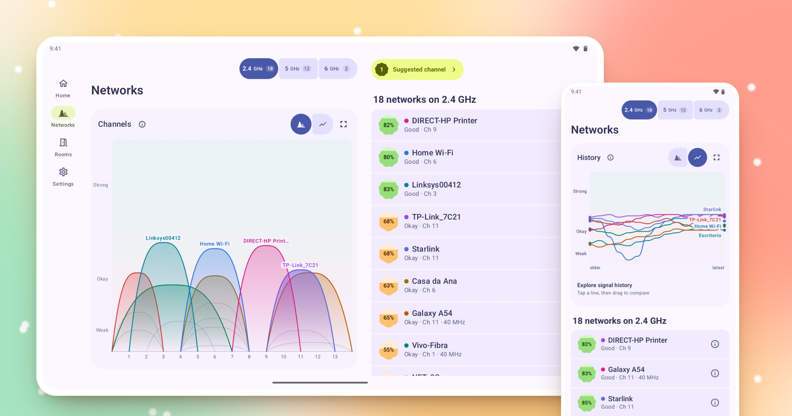
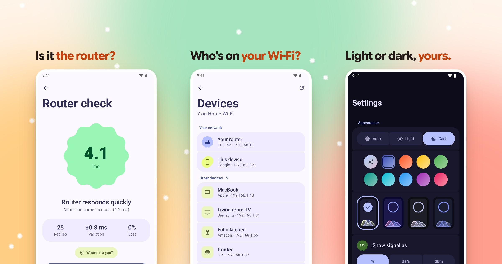

<h1 align="center">
  
</h1>

<b>See where your Wi-Fi gets weak, room by room.</b> 
A Wi-Fi analyzer for Android 8.0 and newer.

  

Every nearby 2.4, 5 and 6 GHz network as a wave, so crowded channels are obvious. Get a suggested channel, or switch to history and watch each signal as you move.

## Tools

  

- **Check your router.** How fast it answers, how steady, and whether replies go missing.
- **Meet your network.** Every device on your Wi-Fi, then ping, DNS lookups and port checks.
- **Make it yours.** Light or dark, wallpaper colors, four styles, and percent, bars or dBm.
- **Room for tablets.** Graphs and lists sit side by side on tablets and foldables.

## Map your home

  

Tap where you stand and the map fills in from red to green. Save a reading in each room to see which one wins, and recheck after moving your router.

## Private by design

No accounts, ads or analytics. Readings, maps and history stay on your device. See the [privacy policy](PRIVACY.md).

## Good to know

Signal strength is not internet speed. The percentage follows the verdicts (Excellent 90–100%, Good 70–89%, Fair 50–69%, Weak 30–49%), and coverage between readings is an estimate.

Screenshots are from the real app on an emulator, with example networks and readings. Building from source or contributing? See [docs/DEVELOPMENT.md](docs/DEVELOPMENT.md).
