<p align="center">
  
</p>

<h1 align="center">WiFi Weakspot</h1>

<p align="center">
  <b>Walk around your home. See exactly where the Wi-Fi drops. Fix it.</b><br>
  A Wi-Fi analyzer for Android that speaks plain language.
</p>

<p align="center">
  
  
  
  
  
</p>

---

Most Wi-Fi analyzers show you a wall of dBm numbers and channel graphs. WiFi Weakspot answers the question you actually have: **which rooms have bad Wi-Fi, and what can I do about it?**

<table>
  <tr>
    <td align="center">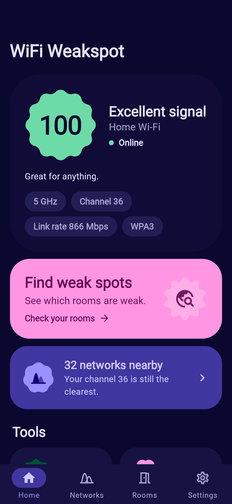<br><sub><b>Your Wi-Fi at a glance</b></sub></td>
    <td align="center">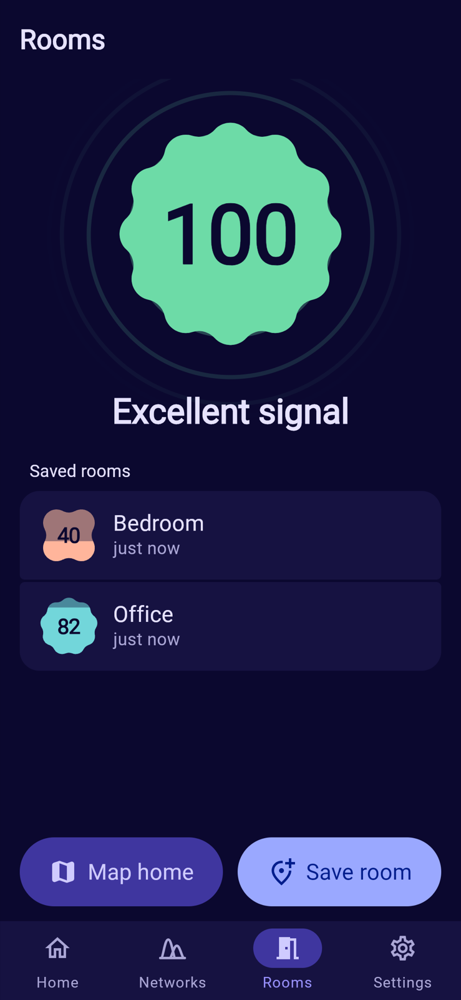<br><sub><b>Check every room</b></sub></td>
    <td align="center">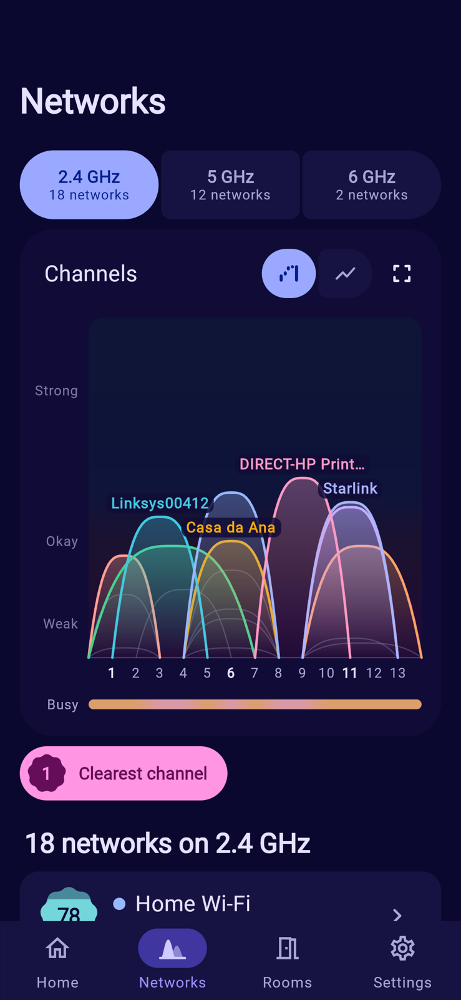<br><sub><b>See every network</b></sub></td>
    <td align="center">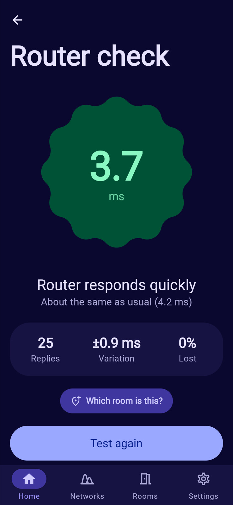<br><sub><b>Check your router</b></sub></td>
  </tr>
</table>

## What it does

**🏠 Rooms: find the weak spots.** Stand in a room and tap *Save room*. Repeat in a few rooms and the weak ones stand out, ranked weakest first, each with a plain signal verdict ("Good signal", "Weak spot"). Move the router, *Recheck*, and see whether it helped. The meter grows and shrinks with the signal as you move, and your phone buzzes when you walk into a weak spot.

**📶 Networks: pick a clearer channel.** Every nearby network drawn as a hill exactly as wide as its channel, colored to match the list. A "busy" strip shows where 2.4 GHz is crowded (tap it for counts), and *signal over time* shows which networks are steady and which come and go. Go full screen and drag across the chart to see exactly who shares each channel. The list holds its order between scans, so rows never jump out from under your finger.

**⚡ Router check: is it the Wi-Fi or the internet?** 25 quick pings to your router give a typical response time, how much it varies, and how many replies went missing, with a tidy history to compare against. It deliberately doesn't pretend to measure internet speed. For that, it hands off to fast.com.

**🗺️ Map home: see your whole home at once.** Walk from room to room and tap where you're standing on a blank grid (or a photo of your floor plan). Each reading takes about two seconds and blends into a smooth coverage map, colored weak to strong, that fades out where you didn't measure, so it never guesses about rooms you skipped. Pinch to zoom, multiple floors, and one tap to share the map as a picture.

<p align="center">
  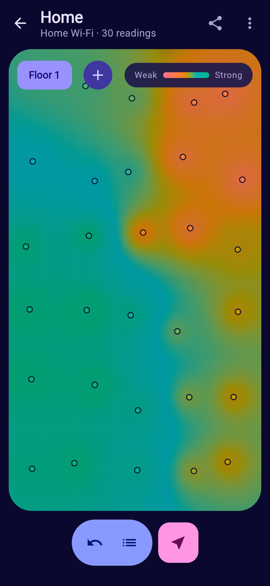&nbsp;&nbsp;&nbsp;
  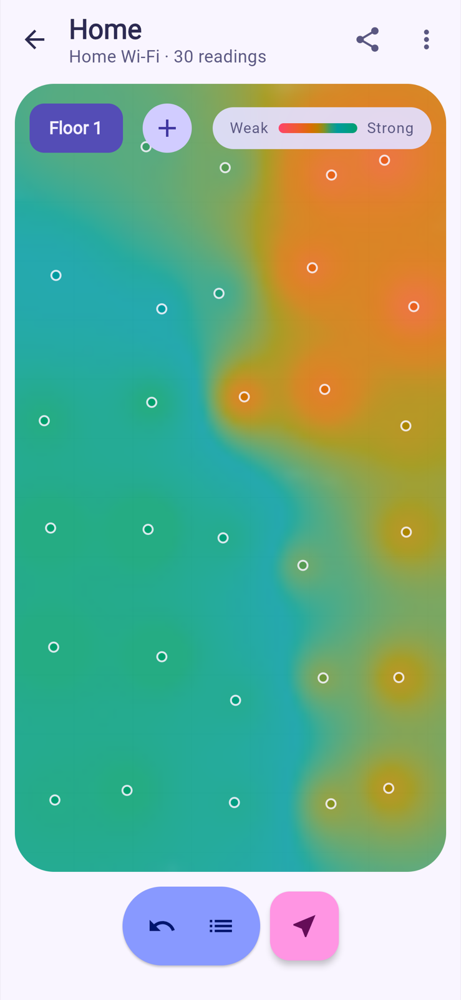
</p>

**🔌 Devices and website checks.** See what's on your network with friendly names gathered over mDNS ("Living room TV", not `192.168.1.31`), then ping, look up or port-check anything.

<table>
  <tr>
    <td align="center"><br><sub><b>Signal over time</b></sub></td>
    <td align="center">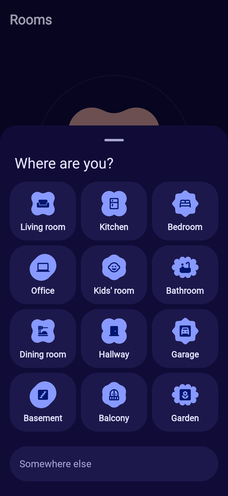<br><sub><b>Where are you?</b></sub></td>
    <td align="center">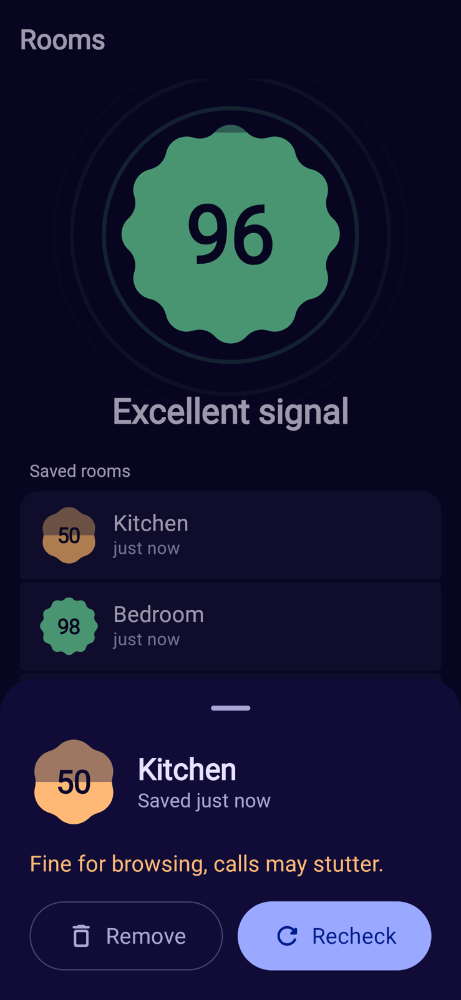<br><sub><b>What a reading means</b></sub></td>
    <td align="center">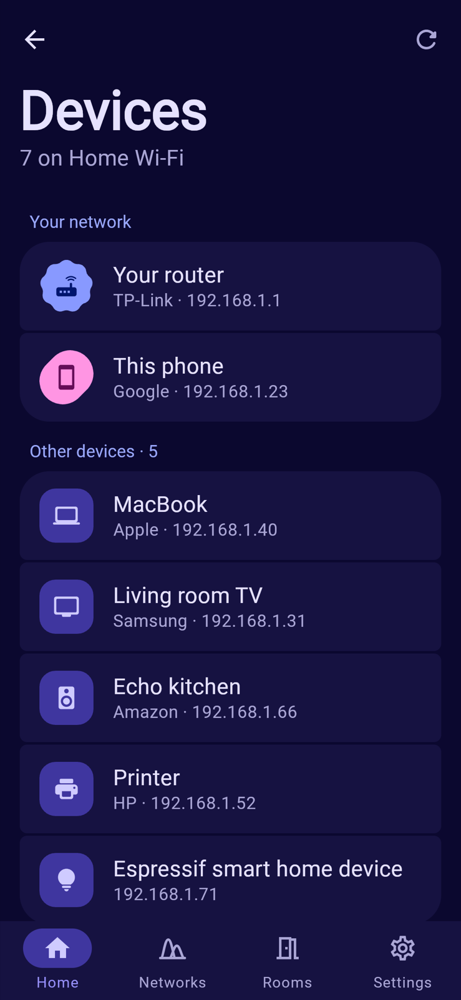<br><sub><b>Who's connected</b></sub></td>
  </tr>
</table>

## Why it's different

- **Plain language first.** A fixed signal percentage, color, and clear quality labels (Excellent, Good, Okay, Weak, Dead zone). Choose bars or raw dBm in Settings; technical details always retain dBm. Signal strength is separate from internet speed.
- **Honest numbers.** No made-up "speed" from link rates and no fake precision. Unavailable readings are shown as unavailable, and distance is labelled as the rough estimate it is.
- **Private by design.** Results stay on the phone. Android calls Wi-Fi scanning "location access", but the app never stores where you are.
- **Fast scans, the right way.** Android limits apps to 4 scans every 2 minutes. The app spots this and walks you through switching the limit off in Developer options. A root option is there if you want it, never forced.
- **Expressive, not decorative.** Shape morphing, spring motion, and haptics carry meaning: the signal blob gains lobes as it improves, and the router gauge needle swings with your last result. Reduced motion is respected.

<table>
  <tr>
    <td align="center">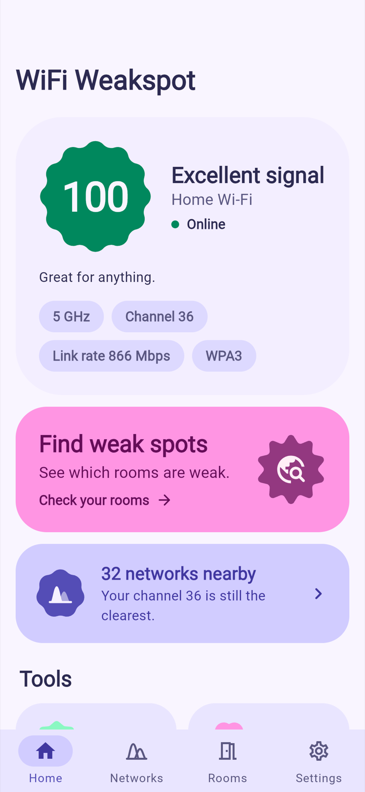</td>
    <td align="center">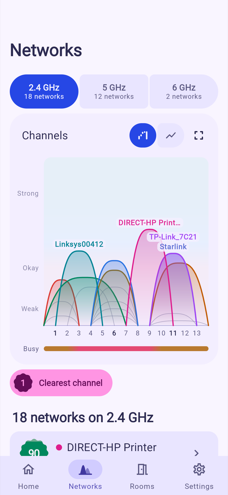</td>
    <td align="center">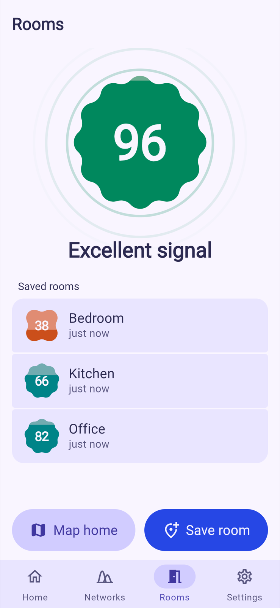</td>
    <td align="center">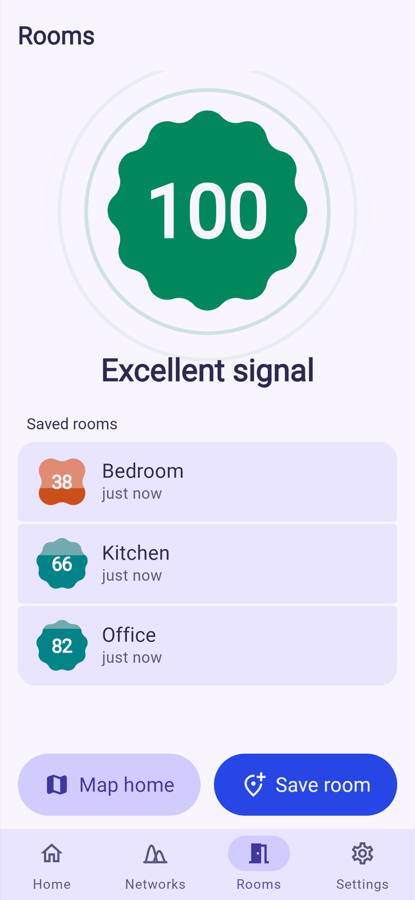</td>
  </tr>
</table>
<p align="center"><sub>Light and dark themes, wallpaper colors or one of nine palettes.</sub></p>

## Built with

| | |
|---|---|
| UI | Compose Multiplatform 1.13, Material 3 1.5 **Expressive** (shape morphing, motion scheme, flexible app bars, connected button groups, segmented lists) |
| Navigation | Navigation 3 with predictive back and shared tab state |
| Data | Room (KMP), DataStore, kotlinx.serialization |
| DI | Koin |
| Language | Kotlin 2.5, coroutines and Flow throughout |
| Web | Kotlin/Wasm: the **same UI code** runs in the browser |

### Architecture

```
composeApp/
  src/main/kotlin      every screen, view model, chart and repository, platform-free
  src/androidMain      Wi-Fi scanning, router probe, mDNS, storage and settings for Android
androidApp/            the Android application shell
webDemo/               Kotlin/Wasm build of the same UI with simulated Wi-Fi
```

The shared code depends only on small interfaces (`WifiScanner`, `RouterProbe`, `PlatformActions`…), so the web demo is the real app, onboarding included, running against a simulated home of ~30 drifting networks.

## Try it

**Android:**

```bash
./gradlew :androidApp:installDebug
```

**In your browser** (no phone needed): every push to `main` publishes the demo to GitHub Pages ([workflow](.github/workflows/web-demo.yml)). To run it locally:

```bash
./gradlew :webDemo:wasmJsBrowserDevelopmentRun
```

Requires JDK 17 and Android SDK platform 37.2. `minSdk` 24, `targetSdk` 36.

## Tests

```bash
./gradlew :composeApp:testDebugUnitTest :androidApp:lintDebug
```

Unit tests cover the signal scale, walk and room summaries, router verdicts, channel geometry (including 80+80 MHz), list ordering, history grouping, floor-plan sampling, database migrations, LAN discovery and the network tools. CI runs tests, lint and a debug build on every push.

## A note on measurements

Signal strength (RSSI) varies with how you hold the phone, so treat a single reading as a guide and compare rooms the same way. Link rate is what the radio negotiated, not real throughput. Some routers ignore pings, and when that happens the app says so instead of guessing.

## License

Apache License 2.0. See [LICENSE](LICENSE).

If this helped you find a dead zone, a ⭐ helps other people find it too.
