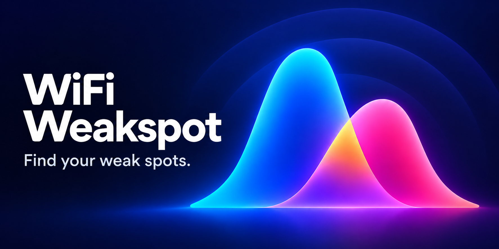
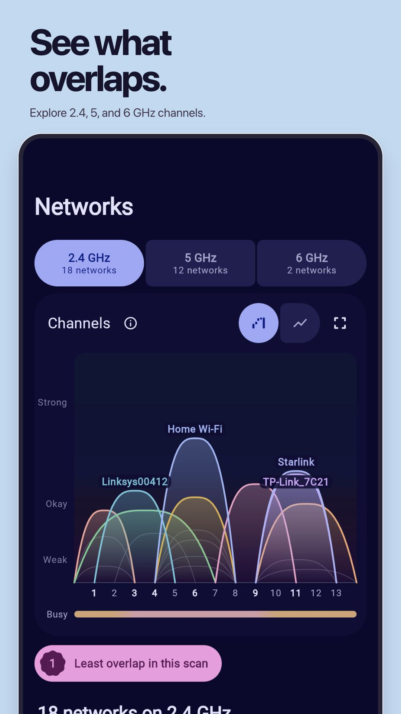
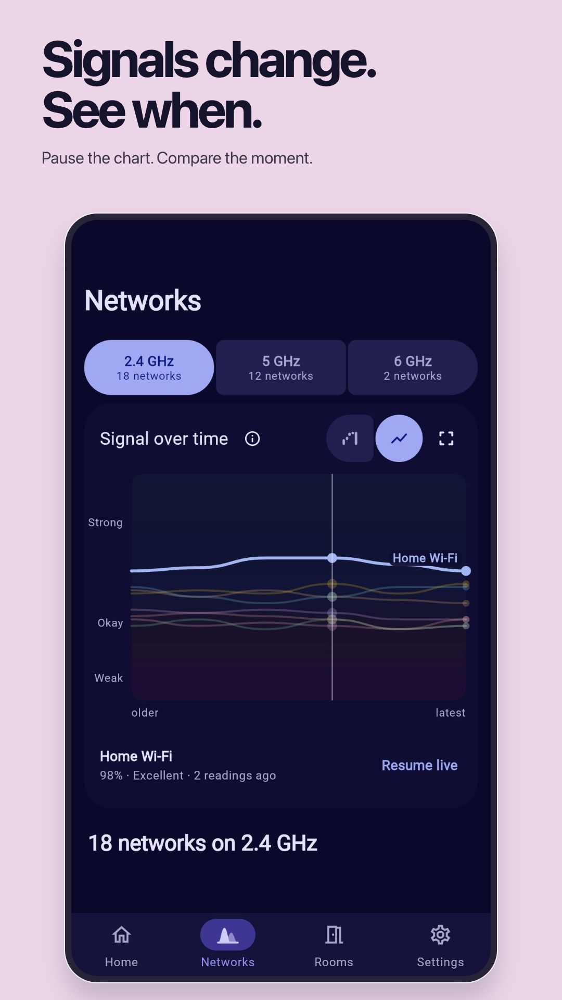
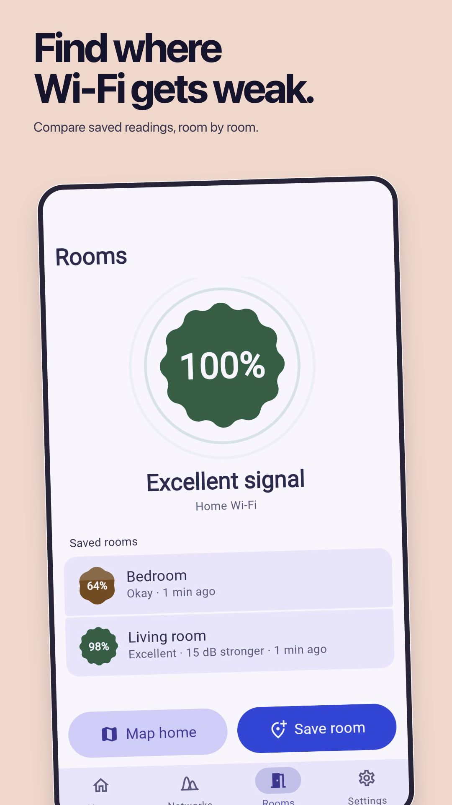
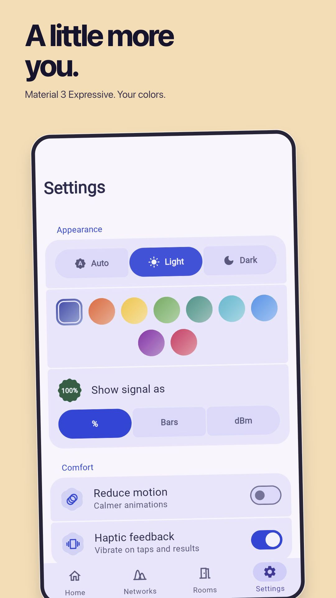
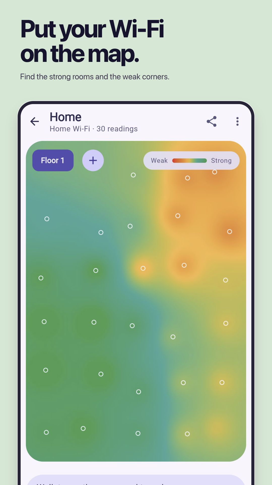
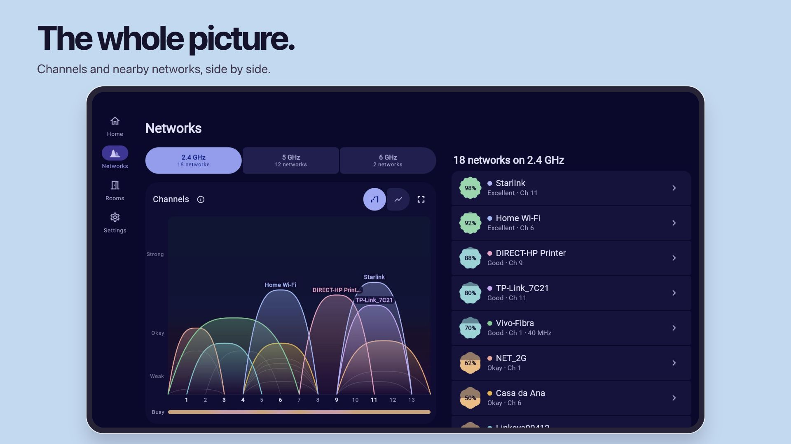

  

<h1 align="center">WiFi Weakspot</h1>

<b>See the signals around you. Find where yours gets weak.</b> 
A Material 3 Expressive Wi-Fi analyzer for Android.

  
  
  
  

Real app UI, example networks and readings. Select an image for a closer look.

## See what overlaps

Explore nearby **2.4, 5, and 6 GHz** networks supported by your device. Channel waves make signal overlap visible; tap a wave for details or expand the chart for a closer look. Switch to signal history, pause a moment, and drag through readings to compare networks at the same point in time.

## Find where Wi-Fi gets weak

Save a reading where the connection feels unreliable, then compare another room. A percentage, color, and plain-language verdict make the difference clear. Recheck the same spots after moving your router or access point to see what changed.

**Put it on a map.** Place readings on a grid or your own floor-plan image to build an estimated coverage map. Keep separate floors, revisit weak corners, and share the results as a picture.

  

## Look beyond signal strength

- **Check your router.** Measure response time, variation, and missed replies. Compare a troublesome room with a spot near the router and keep past checks for reference.
- **Meet your network.** Discover responding devices and the names they announce. Investigate with ping, DNS lookups, and port checks.
- **Make it yours.** Light and dark themes, wallpaper colors, nine palettes, and a choice of percentages, signal bars, or dBm. Adjust motion and haptics to your preference.

## More room to explore

The layout adapts to phones, tablets, and larger screens. On wide displays, the chart and network list sit side by side, with a navigation rail keeping the main tools in reach.

  

## Private by design

**No accounts. No ads. No analytics.** Your saved readings, maps, and history stay on your device; they are not uploaded to the developer. Sharing is your choice. Optional network tests contact the devices or hosts being checked, and internet speed testing opens fast.com. Read the [privacy policy](PRIVACY.md) for permissions, storage, and deletion details.

## Understand the readings

Signal strength is not internet speed. The percentage uses a fixed scale from **−100 dBm (0%) to −50 dBm (100%)**, rather than comparing with the strongest network in a scan. Choose bars or dBm if you prefer.

Coverage between measured points is an estimate. Channel overlap shows observed signals, not network traffic, and does not guarantee faster Wi-Fi. Walls, interference, and how you hold the phone can affect readings, so compare spots under similar conditions.

Android permissions, scan limits, and device support affect what the app can see and how often it refreshes. Some devices hide from discovery or ignore pings; discovery may be unavailable through a VPN. Room comparisons use the network name, so unrelated networks with the same name can share history.

Screenshots come from the browser demo, which shares the Android interface and simulates the phone's radios. The demo does not measure your browser's Wi-Fi.

