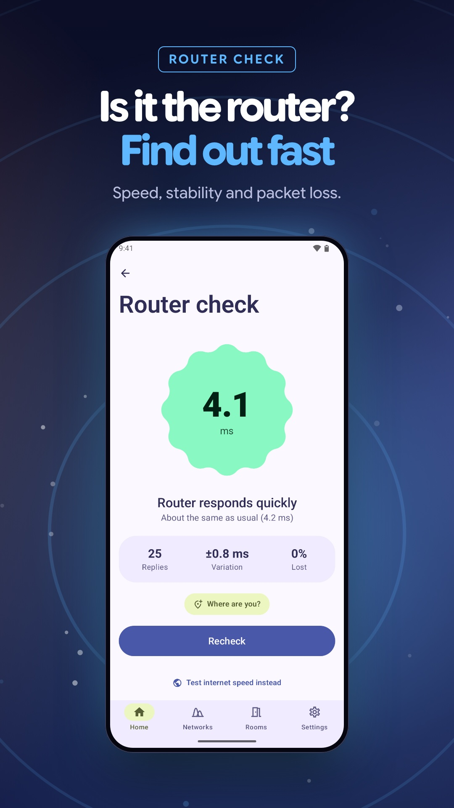
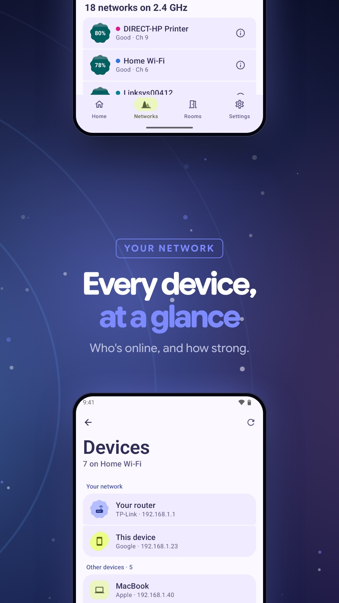
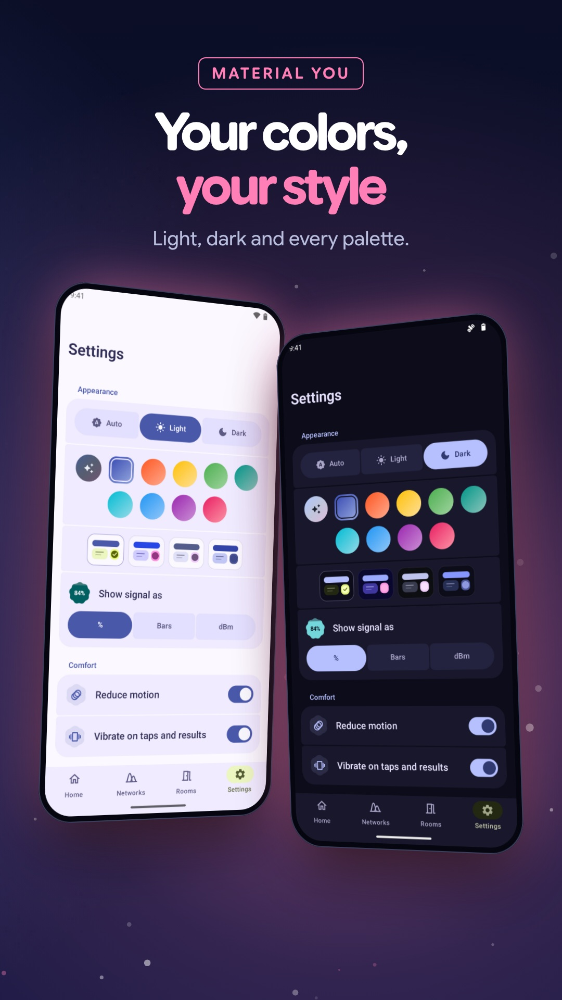

  

<h1 align="center">WiFi Weakspot</h1>

<b>See the signals around you. Find where yours gets weak.</b> 
A Wi-Fi analyzer for Android 8.0 and newer, built with Material 3 Expressive.

  

<table>
  <tr>
    <td width="25%"></td>
    <td width="25%"></td>
    <td width="25%"></td>
    <td width="25%"></td>
  </tr>
</table>

## See what overlaps

Every nearby 2.4, 5 and 6 GHz network, drawn as channel waves so overlap is obvious. Tap a wave for details, get a suggested channel, or switch to history and watch each signal change as you walk around.

## Find where Wi-Fi gets weak

Save a reading in each room and compare them with a percentage, a color and a plain-language verdict. Then tap where you stand on a grid or your own floor plan to build a coverage map, keep separate floors, and share the result as a picture. Recheck the same spots after moving your router to see what changed.

## Look beyond signal strength

<table>
  <tr>
    <td width="33%"></td>
    <td width="33%"></td>
    <td width="33%"></td>
  </tr>
</table>

- **Check your router.** Response time, variation and missed replies, with past checks kept for comparison.
- **Meet your network.** See responding devices and the names they announce, then dig in with ping, DNS lookups and port checks.
- **Make it yours.** Light and dark, wallpaper colors, nine palettes, four styles, and percentages, bars or dBm.

## Made for bigger screens

On tablets the graph and the network list sit side by side.

  

## Private by design

No accounts, ads or analytics. Readings, maps and history stay on your device, and sharing is always your choice. Back up your maps and readings to a ZIP file from Settings. Read the [privacy policy](PRIVACY.md) for permissions, storage and deletion.

## Good to know

Signal strength is not internet speed. The percentage maps −100 dBm to 0% and −50 dBm to 100%; switch to bars or dBm anytime. Coverage between measured points is an estimate, and walls, interference and how you hold the phone all affect readings. Android's scan limits and device support affect what the app can see.

Screenshots are from the real app on an emulator, with example networks and readings. Building from source or contributing? See [docs/DEVELOPMENT.md](docs/DEVELOPMENT.md).
